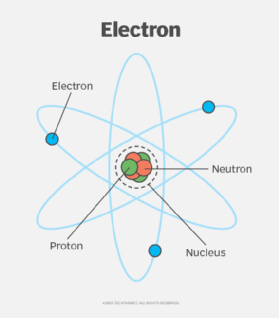
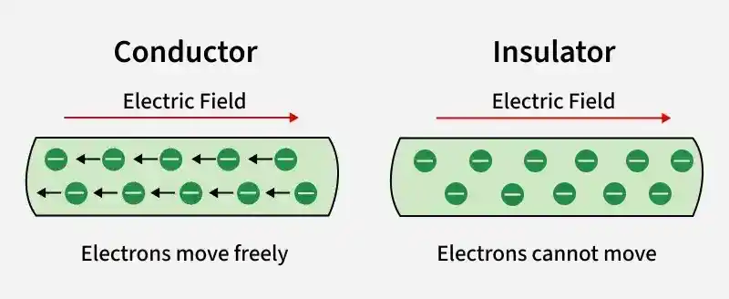
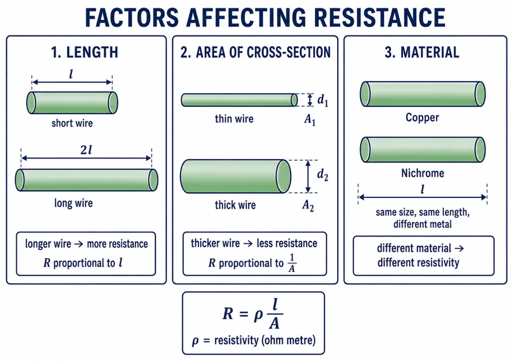
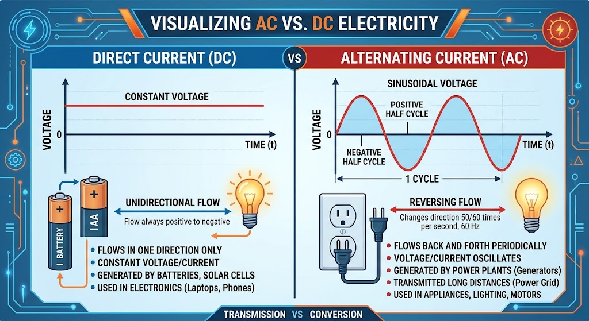

# Chapter #1 - From electrons to electronics

## Concepts

**Electricity** is the movement of electrons through a conductor.

**Electron** is a particle with a negative electric charge.

**Proton** is a particle with a positive electric charge. Protons and electrons attract each other.

**Resistance** is the measurement of how easily electrons can move through a material.

- *Conductors:* materials that allow electric current and electrons to flow through them easily because of low electrical resistance (like marbles in an ice-skating rink). Examples include copper and aluminum.

- *Insulators:* materials that block or severely restrict the flow of electric current because of high electrical resistance (like marbles in sand). Examples include plastic and glass.

The attractive force between positive and negative charges is an electromotive force called **voltage**.

The flow of electrons is referred to as **electric current**.

Electricity can be represented using the water pressure and pipe diameter analogy.

- Increasing water pressure (+ voltage) causes more water (electrons) to flow through the pipe (conductor).

- Using a larger diameter pipe (lower resistance) allows more water (electrons) to flow through the pipe for a given amount of pressure (voltage).

## Source of electricity

- **Batteries.** They use an electrochemical reaction to produce a positive voltage at one terminal and a negative voltage at the other.

- **Electrical outlets.** Electricity is generated at a power plant, such as a dam (hydroelectric energy) or a nuclear power plant.

### Types of current

- **Direct current (DC).** Electrons move in only one direction, from the negative terminal through the wires to the positive terminal.

- **Alternating current (AC).** The electron flow changes direction 120 times per second, completing a full cycle 60 times per second.

  

